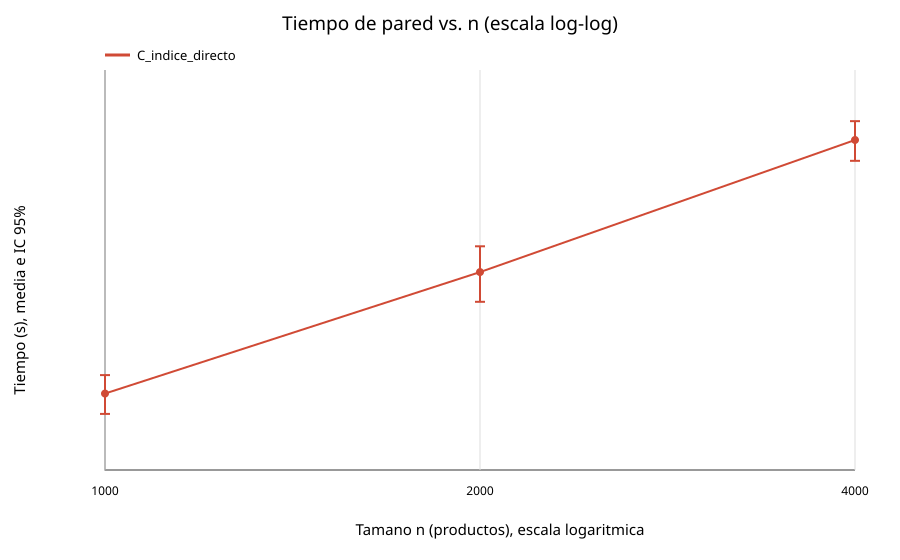

# Equipo 7 — Algoritmos de búsqueda y ordenamiento

> Proyecto: *Laboratorio colaborativo de rendimiento y eficiencia computacional desde la física aplicada*
> Física Aplicada al Desarrollo de Software · SENA · ADSO · 7.º trimestre

## 1. Problema empresarial
**Empresa (caso simulado):** MercaRed Colombia, tienda en línea con catálogo en crecimiento

Con 5 000 productos la actualización del catálogo tardaba segundos; con 50 000 tarda varios minutos. La gerencia pregunta cuánto tardará con 500 000.

## 2. Situación inicial medible

`src/linea_base.py` ordena por inserción y busca cada código linealmente.
Medición formal de A (10 tiempos por caso):

| Tamaño n | Tiempo medio A | Unidad | Equipo y fecha |
|---:|---:|---|---|
| 1 000 | 0.042791 | s | Windows 10 / CPython 3.14.7, 18-11-2026 |
| 2 000 | 0.162089 | s | Windows 10 / CPython 3.14.7, 18-11-2026 |
| 4 000 | 0.662829 | s | Windows 10 / CPython 3.14.7, 18-11-2026 |

## 3. Pregunta de investigación

¿Cómo cambian el tiempo de pared (s) y el pico de memoria Python (MiB) al
reemplazar A por C y aumentar n, manteniendo el mismo equipo, versión de
Python, datos y consultas?

## 4. Hipótesis
Ver [docs/hipotesis.md](docs/hipotesis.md).

## 5. Estrategias
| Id | Estrategia | Idea principal | Resultado esperado | Estado |
|---|---|---|---|---|
| A | Línea base | Inserción y búsqueda lineal | Referencia correcta | Implementada |
| B | Pendiente | Alternativa por asignar | Comparación futura | Pendiente |
| C | Índice directo | Diccionario código -> producto | Evitar ordenamiento y recorridos lineales | Implementada |

La Estrategia C construye un índice de código a producto y usa cada consulta
como clave de búsqueda. No modifica el catálogo recibido ni requiere ordenar
los datos. Su costo principal es recorrer el catálogo una vez para construir el
índice y almacenar una referencia adicional por producto.

## 6. Cómo reproducir
```bash
python -m venv .venv && source .venv/bin/activate      # Windows: .venv\Scripts\activate
pip install -r requirements.txt                          # opcional: psutil, matplotlib
python -m src.linea_base                                 # situación inicial
python -m unittest discover -s pruebas                   # corrección
python -m experimentos.ejecutar_experimento              # experimento formal -> resultados/resultados.csv
python -m experimentos.analizar_resultados resultados/resultados.csv
```

En Windows se puede usar `C:\Python314\python.exe` si el alias `python` no está
configurado.

## 7. Integrantes y roles
| Rol | Integrante | Responsabilidad principal |
|---|---|---|
| R1 — Coordinación y protocolo experimental | _(nombre)_ | Mantiene el protocolo y la bitácora de decisiones; controla variables; modera issues y la planeación. |
| R2 — Desarrollo de estrategia base | _(nombre)_ | Comprende y documenta la línea base; asegura la verificación de corrección (pruebas) de todas las estrategias. |
| R3 — Estrategias alternativas y optimización | _(nombre)_ | Diseña e implementa las estrategias alternativas y justifica físicamente por qué deberían cambiar las magnitudes. |
| R4 — Automatización de mediciones y análisis | _(nombre)_ | Automatiza experimentos y registro CSV; produce estadísticas y gráficos; documenta el entorno. |

Los roles son flexibles: **todos** participan en la comprensión física y en el código.

## 8. Documentación
- [Variables](docs/variables.md) · [Protocolo](docs/protocolo.md) · [Entorno](docs/entorno.md)
- [Decisiones técnicas](docs/decisiones.md) · [Uso de IA](docs/uso_ia.md) · [Informe](docs/informe.md)

## 9. Resultados y conclusiones — Estrategia C

Esta entrega tiene etiqueta propia `v1.0-estrategia-c`; la etiqueta existente
`v1.0` se conserva en su commit de Estrategia-A.

**Enfoque C:** índice hash de código a producto. En 10 repeticiones por
tamaño, el tiempo medio creció de 0.000128 s (n=1 000) a 0.000468 s
(n=4 000); en cada n, el IC 95 % de C no se solapa con el de A. Al
duplicar n, el tiempo creció 1.86× y 1.97×, compatible con el costo esperado
O(n) de construir el índice con q=n/10 consultas. El pico Python pasó de
0.054 a 0.212 MiB; solo hubo una medición de memoria por tamaño.

| n | Tiempo medio C (s) | IC 95 % (s) | CV | Pico Python (MiB) |
|---:|---:|---:|---:|---:|
| 1 000 | 0.0001275 | 0.0001149–0.0001401 | 13.86 % | 0.054 |
| 2 000 | 0.0002377 | 0.0002041–0.0002713 | 19.76 % | 0.106 |
| 4 000 | 0.0004680 | 0.0004206–0.0005154 | 14.17 % | 0.212 |



Como referencia, en n=4 000 A tomó 0.662829 s y C 0.000468 s (1 416× menos
tiempo medio), pero C usó 6.63× más memoria trazada (0.212 frente a 0.032
MiB). Esta sección evalúa específicamente C; el detalle está en
[docs/informe.md](docs/informe.md),
[resultados/resumen_c_indice_directo.csv](resultados/resumen_c_indice_directo.csv)
y [resultados/atipicos_c_indice_directo.csv](resultados/atipicos_c_indice_directo.csv).

En C, los tres CV superaron 10 %. Tukey marcó una corrida en n=2 000 y otra en
n=4 000; no se borraron datos porque el protocolo no registra causas. La CPU
de proceso marcó 0.000000 s en las corridas submilisegundo; frecuencia,
temperatura y energía no estuvieron disponibles. No se afirma ahorro
energético ni se extrapola a 500 000: se recomienda validar con lotes y medir
memoria antes de dimensionar producción.

Reproducir el análisis completo y exportar archivos individuales solo para C:
`python -m experimentos.analizar_resultados resultados/resultados.csv --estrategia C_indice_directo`.
