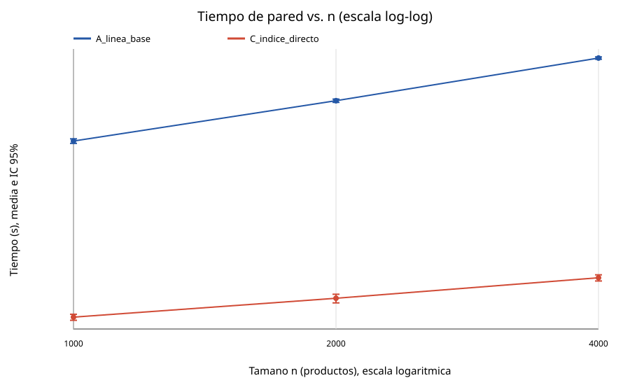
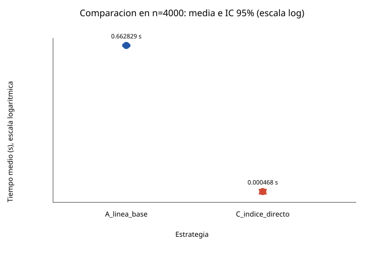

# Informe científico — Equipo 7

**Título:** Comparación experimental de búsqueda del catálogo MercaRed
**Integrantes:** Equipo 7 (nombres por completar)
**Fecha:** 25-11-2026
**Repositorio:** MigueLoaiza7/04_proyecto_Equipos-Equipo-07-MercaRed

## Resumen

Se compararon A (ordenamiento por inserción y búsqueda lineal) y C (índice
directo con diccionario) con catálogos de 1 000, 2 000 y 4 000 productos. Se
midieron diez tiempos por combinación y una corrida separada de memoria.
Windows 10 y CPython 3.14.7. C fue entre 334× y 1 416× más rápida en los
tamaños medidos, usando entre 6.00× y 6.63× más memoria trazada. No se
midió directamente n=500 000 ni se afirma ahorro energético. Una extrapolación
log-log exploratoria de A para ese tamaño se presenta con sus limitaciones en
la sección 7.

## 1. Introducción

El caso simulado MercaRed enfrenta el crecimiento de un catálogo y consultas
por código. La pregunta es: ¿cómo cambian el tiempo de pared y el pico de
memoria al reemplazar A por C, para n=1 000, 2 000 y 4 000, usando los mismos
datos, equipo y consultas?

A ordena por inserción y busca cada código mediante recorrido lineal. C
construye un diccionario código-producto y consulta cada código como clave.
Para datos aleatorios, el número de comparaciones de inserción crece del orden
de n²; las consultas lineales agregan trabajo proporcional a q·n, donde
q=floor(n/10). En C, la construcción recorre n productos y la consulta hash
tiene costo promedio O(1), de modo que el costo esperado del caso medido es
O(n+q).

La relación física aproximada entre ciclos, frecuencia y tiempo es
`N_ciclos = f · t`, donde f se expresa en ciclos/s (Hz) y t en segundos. La
frecuencia no estuvo disponible, así que no se midieron ciclos. El pico
`tracemalloc` representa asignaciones Python observadas, no memoria total,
potencia ni energía.

## 2. Hipótesis

Se conservaron las hipótesis registradas en [hipotesis.md](hipotesis.md):

- **H1 (comparación):** C reducirá el tiempo frente a A para el mismo n.
- **H2 (crecimiento de C):** al duplicar n, el tiempo de C estará entre 1.5× y
  3×.
- **H3 (memoria):** C usará más memoria Python por mantener un índice adicional.

## 3. Método

- **Estrategias:** A línea base (`src/linea_base.py`) y C índice directo
  (`src/estrategia_c.py`).
- **Entrada:** preparación con semilla 7; mismas consultas para ambas
  estrategias. Tamaños 1 000, 2 000 y 4 000.
- **Diseño:** diez corridas de tiempo por estrategia/tamaño; una corrida
  independiente de memoria por combinación; datos preparados antes de iniciar
  el cronómetro; calentamiento y orden aleatorio con semilla 42.
- **Mediciones:** pared con `perf_counter`, CPU de proceso con `process_time`,
  pico Python con `tracemalloc`, RSS opcional. Se usó un intervalo bilateral
  del 95 % para la media con t de Student (df=9, t=2.262).
- **Entorno:** Windows 10, CPython 3.14.7, AMD64, 8 núcleos lógicos. No hubo
  disponibilidad de psutil, frecuencia, temperatura ni RAPL. Aplicaciones y
  alimentación no quedaron registradas. Ver [entorno.md](entorno.md).
- **Reproducibilidad:** `python -m experimentos.analizar_resultados
  resultados/resultados.csv`.

Los scripts indicados en el material de clase
`03_Clase_5/Scripts/analizar_resultados.py` y `verificar_hipotesis.py` no se
encontraron en este repositorio ni en el entorno local. El analizador local
reproduce el resumen estadístico y contraste explícito de criterios; no se
afirma haber ejecutado los scripts oficiales ni el árbol exacto de clase.

## 4. Resultados

Los datos son mediciones reales del CSV, no simulaciones. Las medias, CV e
intervalos se calculan sobre las diez corridas de tiempo. Memoria corresponde
a una única corrida separada y es descriptiva, sin intervalo estadístico.

| n | Estrategia | Media (s) | Desv. estándar (s) | CV | IC 95 % media (s) | Pico Python (MiB) |
|---:|---|---:|---:|---:|---:|---:|
| 1 000 | A | 0.042791 | 0.004481 | 10.47 % | 0.039586–0.045996 | 0.009 |
| 1 000 | C | 0.0001275 | 0.0000177 | 13.86 % | 0.0001149–0.0001401 | 0.054 |
| 2 000 | A | 0.162089 | 0.012104 | 7.47 % | 0.153431–0.170747 | 0.017 |
| 2 000 | C | 0.0002377 | 0.0000470 | 19.76 % | 0.0002041–0.0002713 | 0.106 |
| 4 000 | A | 0.662829 | 0.034502 | 5.21 % | 0.638150–0.687509 | 0.032 |
| 4 000 | C | 0.0004680 | 0.0000663 | 14.17 % | 0.0004206–0.0005154 | 0.212 |

### Integridad y atípicos

El CSV tiene 66 filas: 60 mediciones de tiempo y 6 de memoria. Las columnas
identifican tiempo (s), CPU de proceso (s), CPU (%), memoria Python (MiB), RSS
(MiB), frecuencia (MHz), temperatura (°C), energía (J) y potencia (W), además
de metadatos. `pico_mem_mib` está vacío en las 60 corridas de tiempo porque el
trazado se separó; RSS, frecuencia, temperatura, energía y potencia están
vacíos en las 66 filas porque los sensores/dependencia no estuvieron
disponibles. Ninguna columna estructural está incompleta. Ver
[auditoria_datos.csv](../resultados/auditoria_datos.csv).

Superaron CV=10 %: A n=1 000 (10.47 %) y C n=1 000 (13.86 %), n=2 000
(19.76 %) y n=4 000 (14.17 %). Tukey (1.5·IQR) señaló tres mediciones:

| Estrategia | n | Repetición | Tiempo (s) | CV del grupo |
|---|---:|---:|---:|---:|
| A | 4 000 | 1 | 0.737755 | 5.21 % |
| C | 2 000 | 4 | 0.000351 | 19.76 % |
| C | 4 000 | 3 | 0.000598 | 14.17 % |

CV>10 % y atípico Tukey son criterios distintos. El protocolo no tiene
incidentes registrados que expliquen los puntos; no se borró ninguna fila ni
se asignó una causa como hecho. Para C, las duraciones de 0.1–0.6 ms y los
valores de `process_time()` redondeados a 0.000000 s indican una limitación
instrumental relevante; variación del SO o granularidad efectiva son
posibilidades por investigar, no causas comprobadas.
Ver [atipicos.csv](../resultados/atipicos.csv).

## 5. Discusión y contraste de hipótesis

- **H1 — apoyada dentro del rango medido:** los IC 95 % de A y C no se
  superponen en ninguno de los tres n; los promedios de C son menores. La razón
  A/C es 335.6×, 681.9× y 1 416.3×, respectivamente. La dispersión de C y la
  duración submilisegundo limitan la precisión de las razones, pero no cambian
  la separación observada en este equipo.
- **H2 — apoyada descriptivamente:** al duplicar n, la media de C creció
  1.86× (1 000→2 000) y 1.97× (2 000→4 000), dentro de la predicción 1.5×–3×.
  Tres tamaños no prueban una ley asintótica.
- **H3 — apoyada descriptivamente, evidencia de memoria limitada:** C usó
  0.054, 0.106 y 0.212 MiB, frente a 0.009, 0.017 y 0.032 MiB en A. Es una
  sola corrida por combinación, por lo que no permite estimar dispersión o
  intervalo de memoria.

Las razones de crecimiento de A fueron 3.79× y 4.09× en tiempo al duplicar n,
consistentes con crecimiento superlineal en este intervalo. No se infiere una
ley asintótica a partir de tres puntos. Para responder la pregunta de 500 000,
la sección 7 presenta una estimación exploratoria, no una predicción validada.

## 6. Explicación física/computacional

A realiza comparaciones/traslados para insertar elementos y recorre el
catálogo para cada consulta. Para entradas aleatorias el trabajo dominante
crece aproximadamente con n². C realiza una construcción de índice que crece
con n y búsquedas por clave de costo promedio constante; la cantidad esperada
de operaciones crece aproximadamente con n+q. Menos operaciones se reflejan
en menos tiempo de pared en la misma máquina.

La memoria trazada de C es 6.00×, 6.24× y 6.63× la de A, coherente con espacio
adicional para claves/entradas del diccionario. La lectura no incluye RSS y
puede omitir asignaciones nativas. No se midieron frecuencia, temperatura,
potencia ni energía; por tanto no se calculan ciclos con un f supuesto ni se
afirma reducción de calor o energía. En C, `process_time()` aparece como cero
en 30 corridas; la causa concreta no se pudo aislar y se trata como limitación
instrumental para intervalos tan breves.

## 7. Propuesta de mejora para la empresa

Para el flujo de consultas por código, pilotear C: en el mayor tamaño probado
(4 000) pasó de 0.662829 s a 0.000468 s por ejecución, una mejora medida de
1 416×, con un incremento trazado de memoria de 0.180 MiB (0.032→0.212 MiB).
La recomendación solo aplica al patrón de datos, implementación, CPython y
equipo probados; supone códigos únicos y consultas representativas.

Antes de comprometer capacidad para 50 000 o 500 000, medir esos tamaños con
lotes de ejecuciones de C para superar el límite de resolución, registrar
memoria RSS y repetir memoria. Riesgos: memoria del diccionario, colisiones y
actualización del índice cuando cambia el catálogo; si hay códigos duplicados,
la implementación actual conserva el último producto de ese código.

### Estimación de A para 500 000 productos

Un ajuste lineal de log(tiempo medio) frente a log(n), usando las medias de A
en n=1 000, 2 000 y 4 000, da una pendiente aproximada de 1,977 y estima
9 134 s (2,54 h) para n=500 000. No se ejecutó A a ese tamaño. La estimación
extrapola 125× más allá del mayor tamaño medido y presupone que la tendencia
log-log observada continúa; puede fallar por cambios de caché, memoria,
intercambio a disco, sistema operativo u otras condiciones. Sirve solo para
planificación y no incluye incertidumbre estadística del modelo, energía ni
memoria. Se recomienda reportarla como estimación y realizar una medición
directa solo si la actividad la exige explícitamente, tras acordar la sesión y
registrar las condiciones del [protocolo](protocolo.md).

## 8. Conclusiones

En 1 000–4 000 elementos C redujo sustancialmente el tiempo medido frente a A,
a cambio de aproximadamente seis veces más memoria Python trazada. La
hipótesis de crecimiento casi lineal de C es compatible con los dos cocientes
observados, pero no queda demostrada fuera del rango. Los CV y atípicos se
reportan sin eliminar datos; la instrumentación de tiempo/CPU requiere mejorar
para ejecuciones submilisegundo. No hay evidencia de ahorro energético.

### Nota separada: serie 3 controlada A/B/C

La serie 3 del 25-11-2026 usa CPython 3.12.10 y no se combina con la medición
histórica de este informe, realizada con CPython 3.14.7. En el análisis de las
tres series A/B/C, todas las nueve combinaciones de estrategia y tamaño
mantuvieron CV combinado >10 %. Para A, los CV fueron 16,07 %, 18,34 % y
19,11 % en n=1 000, 2 000 y 4 000. La tercera serie se tomó bajo las condiciones
controladas registradas en [entorno.md](entorno.md), pero la dispersión
combinada sigue siendo una limitación: los resultados son exploratorios y no
justifican repetir la medición automáticamente. Una corrida adicional solo
tendría sentido con una condición concreta identificada y un plan de control
documentado de antemano. El resumen de las tres series está en el
[registro de análisis A/B/C](https://github.com/MigueLoaiza7/04_proyecto_Equipos-Equipo-07-MercaRed/blob/c411d194ea61e3b59b8b67bba8572556e2109b21/resultados/resumen_estadistico_A_B_C.csv).

## 9. Referencias y artefactos

- CSV fuente: [resultados.csv](../resultados/resultados.csv)
- Estadísticas reproducibles: [resumen.csv](../resultados/resumen.csv)
- Auditoría: [auditoria_datos.csv](../resultados/auditoria_datos.csv)
- Atípicos: [atipicos.csv](../resultados/atipicos.csv)
- Código de análisis: [analizar_resultados.py](../experimentos/analizar_resultados.py)
- [Protocolo](protocolo.md), [hipótesis](hipotesis.md), [entorno](entorno.md)
- Registro de IA: [uso_ia.md](uso_ia.md)
