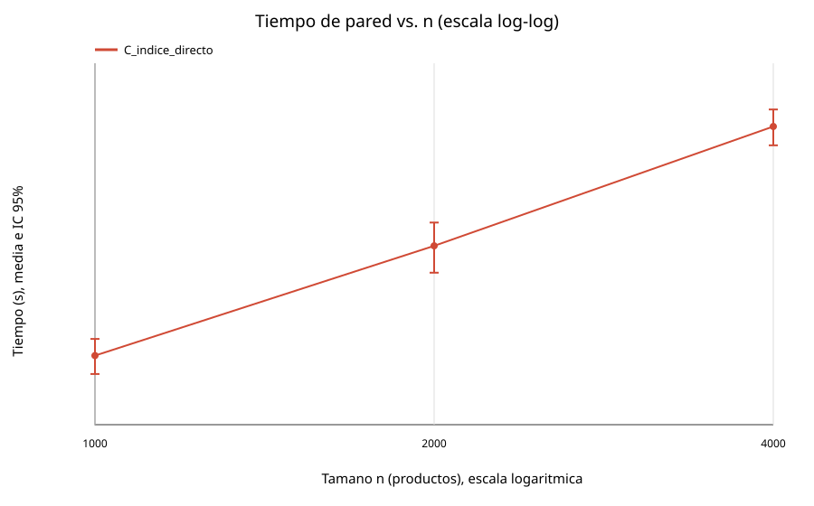

# Informe científico — Estrategia C

**Título:** Evaluación experimental del índice directo para consultas de MercaRed
**Equipo:** 7 (integrantes por completar)
**Fecha del informe:** 25-11-2026
**Datos medidos:** 18-11-2026, Windows 10, CPython 3.14.7

## Resumen

Se evaluó C, que crea un diccionario código-producto y consulta por clave, con
catálogos de 1 000, 2 000 y 4 000 productos. Se tomaron diez tiempos y una
corrida separada de memoria por tamaño. El promedio de C creció de 0.0001275 s
a 0.0004680 s, con factores 1.86× y 1.97× al duplicar n. A 4 000, C fue
1 416× más rápida que A, pero trazó 0.212 MiB frente a 0.032 MiB de A. Los
resultados describen este rango; no predicen 500 000 ni demuestran ahorro de
energía.

## 1. Problema y pregunta

MercaRed Colombia necesita atender consultas por código mientras aumenta su
catálogo. Esta evaluación se concentra en la Estrategia C, no en describir o
repetir el informe de la línea base: ¿cómo escalan el tiempo y la memoria del
índice directo cuando n crece, y qué intercambio ofrece frente a A en los
mismos datos?

## 2. Estrategia evaluada e hipótesis

C crea una tabla hash `codigo -> producto` recorriendo el catálogo una vez y
busca cada consulta con `dict.get`. En el conjunto de datos usado los códigos
son únicos. La implementación está en [src/estrategia_c.py](../src/estrategia_c.py).

Se contrastaron las hipótesis registradas antes de interpretar estas
mediciones en [hipotesis.md](hipotesis.md):

- **H1:** C reduce el tiempo frente a A para el mismo tamaño.
- **H2:** el tiempo de C crece entre 1.5× y 3× cuando se duplica n.
- **H3:** C utiliza más memoria Python que A por almacenar el índice.

## 3. Método

- Tamaños: 1 000, 2 000 y 4 000 elementos.
- Datos y consultas: misma entrada generada con semilla 7; preparación fuera
  del cronómetro.
- Repeticiones: diez mediciones de pared por estrategia y tamaño; una
  medición de memoria separada por combinación.
- Diseño: una ejecución de calentamiento; orden aleatorio con semilla 42.
- Instrumentos: `perf_counter` (s), `process_time` (s), `tracemalloc` (MiB);
  RSS, frecuencia, temperatura y RAPL disponibles solo si existen sus sensores.
- Estadística: media, desviación muestral, CV y IC bilateral del 95 % con
  t-Student para 9 grados de libertad (t=2.262). Tukey identifica valores
  fuera de 1.5·IQR.
- Equipo: Windows 10, CPython 3.14.7, AMD64, ocho núcleos lógicos. No hubo
  `psutil`, frecuencia, temperatura ni energía RAPL.

El arnés midió la ejecución completa de C, incluida la construcción del índice
y las consultas; el tiempo no se limita a una llamada aislada a `dict.get`.
La comparación con A se usa como referencia, manteniendo el mismo catálogo.

## 4. Resultados de C

| n | Media (s) | Desv. estándar (s) | CV | IC 95 % de la media (s) | Pico Python (MiB) |
|---:|---:|---:|---:|---:|---:|
| 1 000 | 0.0001275 | 0.0000177 | 13.86 % | 0.0001149–0.0001401 | 0.054 |
| 2 000 | 0.0002377 | 0.0000470 | 19.76 % | 0.0002041–0.0002713 | 0.106 |
| 4 000 | 0.0004680 | 0.0000663 | 14.17 % | 0.0004206–0.0005154 | 0.212 |



El tiempo aumentó 1.86× entre 1 000 y 2 000, y 1.97× entre 2 000 y 4 000.
La memoria trazada creció 1.96× y 2.00× respectivamente. Es coherente con
construir un índice de tamaño O(n), pero tres puntos no demuestran una
complejidad asintótica ni permiten extrapolar a cientos de miles de elementos.

### Comparación de referencia con A

| n | Media A (s) | Media C (s) | Razón A/C | Memoria A (MiB) | Memoria C (MiB) |
|---:|---:|---:|---:|---:|---:|
| 1 000 | 0.042791 | 0.0001275 | 335.6× | 0.009 | 0.054 |
| 2 000 | 0.162089 | 0.0002377 | 681.9× | 0.017 | 0.106 |
| 4 000 | 0.662829 | 0.0004680 | 1 416.3× | 0.032 | 0.212 |


En cada n los IC de tiempo de C y A no se superponen. La comparación solo es
válida para este código, esta carga de consultas y este equipo. C utilizó
aproximadamente 6.00×, 6.24× y 6.63× el pico Python de A. Hay una sola corrida
de memoria por celda: los cocientes de memoria son descriptivos, no estimaciones
con intervalo.

## 5. CV, atípicos e integridad

Los tres grupos de C superan el umbral CV=10 %. Tukey detectó dos puntos:

| n | Repetición | Tiempo (s) | Límite superior Tukey (s) |
|---:|---:|---:|---:|
| 2 000 | 4 | 0.000351 | 0.000293375 |
| 4 000 | 3 | 0.000598 | 0.000589500 |

En n=1 000 el CV es 13.86 %, pero Tukey no marca una corrida; ambos criterios
responden a preguntas distintas. El protocolo no contiene un incidente que
explique las mediciones detectadas. Se conservaron todos los valores y no se
asignó una causa como hecho. Los tiempos de C están entre décimas de
milisegundo; `process_time` quedó en 0.000000 s en las diez corridas de cada
tamaño. Esto revela una limitación del registro de CPU para esta duración; el
origen exacto no quedó aislado. Una repetición futura debería medir lotes.

El CSV fuente contiene 66 filas: 30 mediciones de tiempo de C y 3 de memoria
de C, además de las 33 de A. Campos de trazado de memoria quedan vacíos en las
corridas temporizadas por diseño; RSS, frecuencia, temperatura, energía y
potencia quedan vacíos porque no estaban disponibles. La auditoría completa
está en [auditoria_datos.csv](../resultados/auditoria_datos.csv), el resumen
C-only en [resumen_c_indice_directo.csv](../resultados/resumen_c_indice_directo.csv)
y las filas Tukey de C en
[atipicos_c_indice_directo.csv](../resultados/atipicos_c_indice_directo.csv).

## 6. Contraste de hipótesis

- **H1 — apoyada:** en los tres tamaños, la media de C es inferior a A y los
  IC del 95 % no se superponen. La razón observada creció de 335.6× a
  1 416.3×. No se generaliza a otras cargas ni equipos.
- **H2 — apoyada dentro del rango:** los dos factores de crecimiento de C
  (1.86× y 1.97×) caen dentro de 1.5×–3×. El CV superior al 10 % exige cautela;
  no se ha probado la ley de crecimiento fuera de 1 000–4 000.
- **H3 — respaldada descriptivamente:** los tres picos de C superan los de A,
  como predice el almacenamiento del diccionario. La muestra de memoria es
  n=1 por combinación, así que no hay base para inferencia estadística sobre
  esa diferencia.

No se ejecutaron los archivos oficiales
`03_Clase_5/Scripts/analizar_resultados.py` ni `verificar_hipotesis.py` porque
no se encontraron en el repositorio ni en el entorno local. El análisis se
reproduce con `python -m experimentos.analizar_resultados resultados/resultados.csv`;
el código utiliza la biblioteca estándar y deja estadísticas y gráficos
guardados. La interpretación H1–H3 sigue los criterios descritos aquí y en la
tabla del proyecto, no una salida atribuida a los scripts ausentes.

## 7. Interpretación física y recomendación

El índice requiere n inserciones esperadas y q consultas promedio O(1), de
modo que el trabajo esperado es O(n+q), con q=floor(n/10). En contraste, A
ordena con inserción y recorre linealmente para cada consulta. Menos
operaciones reducen tiempo de CPU y tiempo de pared en la misma máquina.
Construir la tabla y guardar claves/referencias añade memoria O(n); las
colisiones pueden degradar el costo de hash y la implementación reemplaza la
entrada previa si aparece un código duplicado.

Se recomienda pilotear C en consultas frecuentes cuando los códigos sean
únicos y haya memoria suficiente. En n=4 000 la mejora medida fue 1 416×
(0.662829 s→0.000468 s), con incremento de 0.180 MiB de pico trazado
(0.032→0.212 MiB). Para catálogos que cambian, se debe definir cómo mantener
el índice. Antes de dimensionar 50 000 o 500 000, repetir a esos tamaños,
medir lotes para resolver tiempos submilisegundo e incluir RSS.

No se midieron ciclos porque no se obtuvo frecuencia de CPU. No hay datos de
temperatura, potencia o energía; por tanto, no se afirma reducción de calor ni
ahorro eléctrico. `tracemalloc` no equivale a memoria residente total.

## 8. Reproducción y archivos

```powershell
python -m unittest discover -s pruebas
python -m experimentos.analizar_resultados resultados/resultados.csv --estrategia C_indice_directo
```

- Datos originales: [resultados.csv](../resultados/resultados.csv)
- Estadísticas globales: [resumen.csv](../resultados/resumen.csv)
- Resumen C: [resumen_c_indice_directo.csv](../resultados/resumen_c_indice_directo.csv)
- Datos del entorno: [resultados.entorno.json](../resultados/resultados.entorno.json)
- Protocolo: [protocolo.md](protocolo.md)
- Hipótesis: [hipotesis.md](hipotesis.md)
- Bitácora de IA: [uso_ia.md](uso_ia.md)
